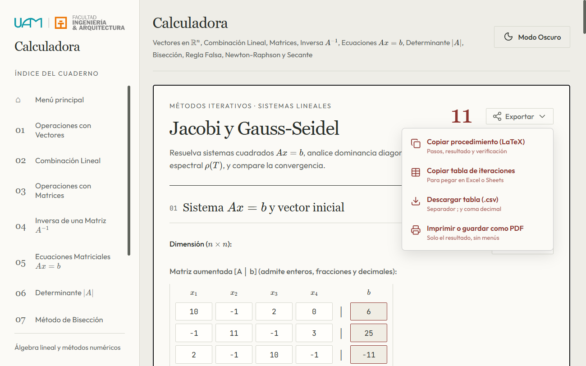
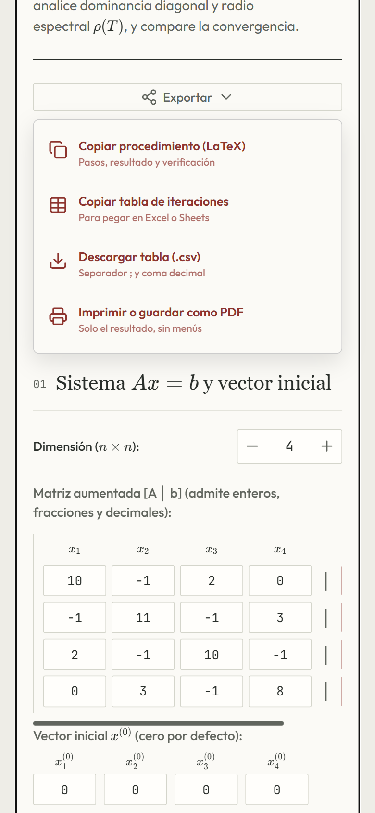

# Propuesta visual P2: copiar, exportar e imprimir (pendiente de aprobación)

Estado: **solo propuesta**. Nada de esto está en la interfaz. Las capturas son maquetas dibujadas sobre la página real
en el navegador, sin modificar el código, para mostrar el aspecto con la identidad visual actual.

## Un solo control por módulo
- Botón **«Exportar»** en la cabecera de cada módulo (junto al número del capítulo), con el estilo existente del botón
  «Limpiar» (`btn-clear`) y los iconos lucide ya incluidos. **Uno por módulo**, no uno por tarjeta ni por tabla.
- Está desactivado hasta que hay un resultado; al calcular se activa. Abre un menú con:
  1. **Copiar procedimiento (LaTeX)**: entrada, pasos, resultado y verificación como documento LaTeX compilable.
  2. **Copiar tabla de iteraciones**: texto tabulado, listo para pegar en Excel o Google Sheets (solo en los módulos
     con tabla: bisección, regla falsa, Newton, secante y Jacobi/Gauss-Seidel).
  3. **Descargar tabla (.csv)**: separador `;` y coma decimal (Excel en español); con opción coma/punto si se prefiere.
  4. **Imprimir o guardar como PDF**: usa el diálogo de impresión del navegador o de la ventana de escritorio.
- Confirmación discreta «Copiado» junto al botón (región `aria-live`), sin ventanas emergentes.

## Móvil
El botón pasa a ocupar el ancho completo debajo de la descripción del módulo y el menú se despliega en línea, con
áreas táctiles de 48 px. Sin desbordamiento horizontal (comprobado a 390 px).

## Impresión / PDF
Hoja de estilo `@media print` exclusiva para imprimir: oculta la barra lateral, la navegación, los controles de
entrada y los botones; conserva el título del módulo, un resumen de la entrada, el procedimiento, el resultado, la
verificación, las tablas (repitiendo el encabezado en cada página) y las gráficas. Las fórmulas KaTeX se imprimen
como vectores. No cambia nada de lo que se ve en pantalla.

## Qué no cambia
Colores, tipografía, disposición, navegación y flujos de los once módulos. El formato común de procedimientos
(`src/procedimientos/`) y `exportar.js` se preparan en la etapa 3 sin cargarse; P2 solo añadiría el botón y su menú.

## Decisiones que necesito
1. ¿Apruebas **un botón «Exportar» por módulo en la cabecera** (alternativa: uno solo en la cabecera general de la
   aplicación, que exportaría el módulo visible)?
2. CSV: ¿separador `;` con coma decimal por defecto (Excel en español) o `,` con punto decimal?
3. Observación aparte: el subtítulo de la cabecera general enumera los módulos hasta «Secante» y no menciona
   «Jacobi y Gauss-Seidel». ¿Lo actualizo (es un cambio de texto visible)?
